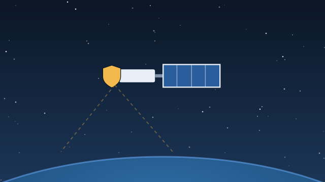
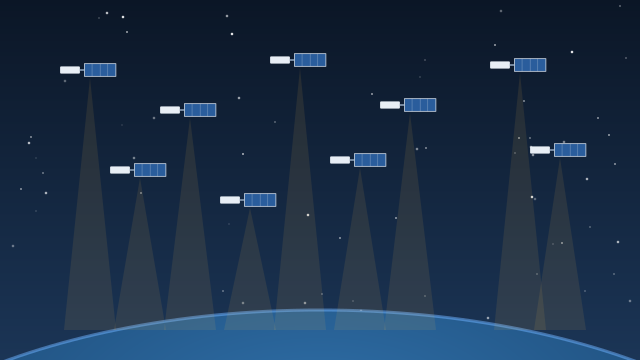
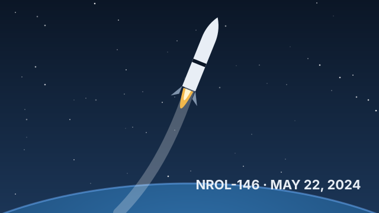
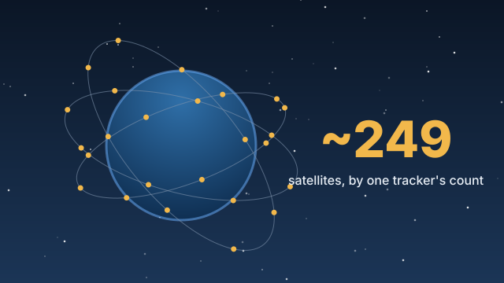
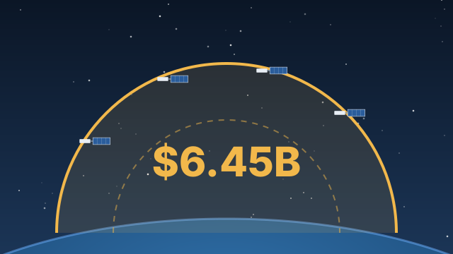

# Starshield in 14 cards

Built from [research.md](research.md). Cards marked *Reported* rest on single or anonymous sources. Images are illustrations, not photos.

## 1. Starshield is SpaceX's military version of Starlink

**Basics** · 2022-12

SpaceX unveiled Starshield in December 2022 as a satellite line for government and military customers. It covers secure communications, Earth-imaging payloads, and government payloads hosted on Starlink-derived satellites.

Source: [Space.com](https://www.space.com/spacex-starshield-space-force-contract)

## 2. Musk: the U.S. government controls Starshield

**Basics** · 2026-10-15

In October 2026 Elon Musk said Starshield systems are "owned and controlled by the U.S. government" and that any limits on speed or usage are decided by the U.S. military "and ultimately POTUS."

Source: [CNBC](https://www.cnbc.com/2026/10/15/elon-musk-starlink-ukraine-trump-energy-ceasefire.html)

## 3. SpaceX is building a spy-satellite network for the NRO

**Contracts & Money** · 2024-03-16 · *Reported*

Reuters reported in March 2024 that Starshield is building hundreds of imaging satellites for the National Reconnaissance Office that can operate as a swarm in low orbit. The 2021 contract is reported at about $1.8 billion, a figure never officially confirmed.

Source: [Spaceflight Now](https://spaceflightnow.com/?p=66251)

## 4. First NRO proliferated-constellation launch: May 2024

**Timeline** · 2024-05-22

The NROL-146 mission launched on a Falcon 9 from Vandenberg on May 22, 2024, the first launch of the NRO's new proliferated architecture. Every NRO Starshield mission since has also flown on Falcon 9 from Vandenberg.

Source: [Spaceflight Now](https://spaceflightnow.com/?p=66251)

## 5. Roughly 250 Starshield satellites may be in orbit

**Capabilities** · 2026-10 · *Reported*

No official count exists. A third-party tracker counts about 249 Starshield satellites across 14 missions, about 245 of them for the NRO.

Source: [Orbital Radar](https://orbitalradar.com/starshield-satellites)

## 6. The first public Starshield deal was worth $70 million

**Contracts & Money** · 2023-09-01

In September 2023 the Space Force signed a one-year, $70 million Starshield task order, the first award under a satellite-services program shared by 16 vendors and capped at $900 million.

Source: [Space.com](https://www.space.com/spacex-starshield-space-force-contract)

## 7. SpaceX won about $6.45 billion for Golden Dome in one week

**Contracts & Money** · 2026-05-29

In late May 2026 the Space Force gave SpaceX $2.29 billion for a military data network and $4.16 billion for satellites that track airborne threats, both parts of the Golden Dome missile-defense effort.

Source: [Bloomberg](https://www.bloomberg.com/news/articles/2026-05-29/spacex-wins-4-billion-contract-for-us-golden-dome-satellites)

## 8. Starshield will carry a new military data network

**Capabilities** · 2026-05-26

The $2.29 billion Space Data Network Backbone, formerly called MILNET, is built on Starshield, with a prototype due by the end of 2027. Earlier reports put its size at about 480 satellites, though estimates vary.

Source: [DefenseScoop](https://defensescoop.com/2026/05/27/space-force-awards-spacex-contract-backbone-satcom-network/)

## 9. The Pentagon paid for Ukraine to use about 3,000 Starshield terminals

**Players** · 2024

A Pentagon contract in late 2024 expanded Ukraine's military Starshield access from roughly 500 to roughly 3,000 terminals. These are separate from the tens of thousands of commercial Starlink terminals, many paid for by Poland.

Source: [Fortune](https://fortune.com/2026/10/19/ukraine-starlink-starshield-drone-speed-limit-musk-trump/)

## 10. Ukraine's drones lose Starshield above about 100 mph

**Controversy** · 2026-10-14

Around October 13, 2026, Ukrainian officials said military Starshield terminals cut out above roughly 160 km/h, without warning. Some units reported drops at even lower speeds, which hurts strike drones and Shahed interceptors.

Source: [Tom's Hardware](https://www.tomshardware.com/tech-industry/drones/spacex-limits-starlink-service-for-ukraines-high-speed-military-drones-without-prior-warning-ukrainian-officials-say-limitation-significantly-complicates-logistics-and-drone-operations)

## 11. Who ordered the cap? Musk, Reuters and Rubio disagree

**Controversy** · 2026-10-16 · *Reported*

Musk pointed to the U.S. government. Reuters, citing two U.S. officials and one Western official, reported the order came from inside the White House. Secretary of State Rubio called that "categorically false."

Source: [CNBC](https://www.cnbc.com/2026/10/16/order-to-limit-starshield-for-ukraine-came-from-inside-white-house-reuters-reports.html)

## 12. Rubio: Ukraine has no Starshield access for now

**Controversy** · 2026-10-18

On October 18, 2026, Rubio said Starshield is currently unavailable to Ukraine, and that Kyiv's request to use it for deep strikes inside Russia is "under discussion." Senators Tillis and Shaheen have pushed back on the limits.

Source: [Al Jazeera](https://www.aljazeera.com/news/2026/10/18/rubio-says-ukraine-without-access-to-starshield-future-under-discussion)

## 13. Lawmakers question Musk's role in defense contracts

**Controversy** · 2025-05

In May 2025, 42 Democratic lawmakers asked the Pentagon inspector general to look at Musk's role in Golden Dome contracting while he served in government. SpaceX went on to win about $6.45 billion in Golden Dome awards.

Source: [The Hill via Yahoo](https://www.yahoo.com/news/democrats-eye-musk-role-missile-174511640.html)

## 14. Much of Starshield is still classified

**Players** · 2026-06-06

The NRO confirms the program but won't describe SpaceX's role, and some launches carry Starshield satellites for undisclosed customers, such as two that flew alongside 21 Starlinks on June 6, 2026.

Source: [Spaceflight Now](https://spaceflightnow.com/2026/06/06/spacex-to-launch-2-starshield-satellites-during-saturday-night-starlink-mission/)
